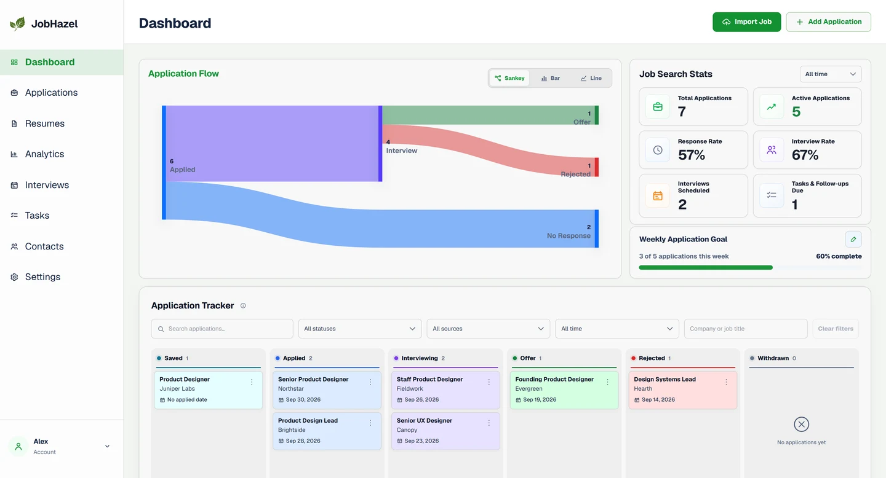
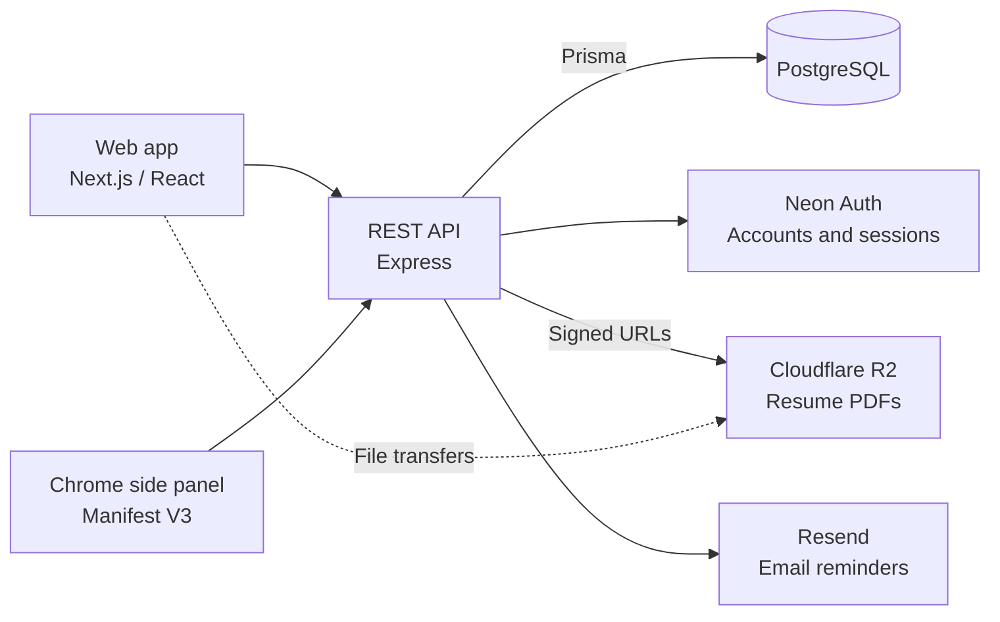

# JobHazel

**A full-stack job application tracker with a companion Chrome extension.**

JobHazel keeps applications, interviews, contacts, follow-ups, and resume versions in one workspace. Import a job posting, track it through the hiring process, and see which sources and resume versions lead to responses.

Built by **[Antonio Indindoli](https://github.com/AntonioIndindoli)** · **[Visit JobHazel](https://jobhazel.com/)**

[Features](#features) · [Engineering](#engineering-highlights) · [Architecture](#architecture) · [Testing](#testing) · [Local setup](#local-development)

<picture>
  <source media="(prefers-color-scheme: dark)" srcset="frontend/public/landing/dashboard-preview-dark-1440.webp">
  
</picture>

*Dashboard preview with fictional sample data.*

## Features

| Workflow | What you can do |
| --- | --- |
| Track applications | Organize roles in a searchable list or drag-and-drop Kanban board, with notes, salary details, and activity history. |
| Import job postings | Paste a URL or description, review extracted fields, and save an application. The Chrome side panel also captures the selected LinkedIn job. |
| Plan the next step | Manage interviews, recruiter contacts, and follow-up tasks, with optional task automation and email reminders. |
| Keep resume history | Upload PDF versions, attach the version used for each application, and compare their recorded outcomes. |
| Understand progress | Explore the application pipeline, response rates, source comparisons, weekly activity, and a geographic map. |
| Manage your data | Export account data as JSON or applications as CSV. Use the responsive interface in light or dark mode. |

Applications move through six stages: **Saved, Applied, Interviewing, Offer, Rejected, and Withdrawn**.

## Engineering highlights

- **Reusable React workspaces.** Shared search/filter controls and resizable detail panes keep application, interview, task, and contact screens consistent. Pane state persists between visits, with pointer and keyboard resizing. [Detail-pane hook](frontend/app/components/useCollectionDetailPane.ts).
- **Application saves commit together.** The application, company, selected resume, activity history, and generated follow-up task share one database transaction. An invalid resume rejects the entire save. [Application service](backend/src/services/applications.services.js).
- **Resume files have a defined lifecycle.** The API issues short-lived upload/download URLs, checks stored file size, content type, and PDF signature, and prevents deletion of resumes still linked to applications. [Resume service](backend/src/services/resumes.services.js).
- **Import retries preserve work.** Capture IDs allow draft reuse; conversion claims a draft inside the same transaction that creates its application. Retrying a completed conversion returns its saved state. [Import service](backend/src/services/imports.services.js).
- **Account access has explicit controls.** Neon Auth handles verification and recovery. Web credentials stay in HttpOnly cookies, mutations check request origins, and authentication rate limits persist in the database. [Session handling](backend/src/services/neon-auth.services.js) · [Origin checks](backend/src/middleware/session-origin.middleware.js).
- **Reminder state survives failed requests.** Database records track scheduling, retries, cancellations, and uncertain provider responses. Shared provider throttling and health reporting support operation across API instances. [Notification design](backend/NOTIFICATIONS.md).

## Architecture



The web app and extension share the API and import workflow. The API stores application data in PostgreSQL and manages access to resume files; the browser transfers PDFs directly to and from R2. Authentication and reminder delivery use separate providers.

## Technology summary

| Area | Technologies |
| --- | --- |
| Web interface | Next.js 16, React 19, TypeScript, custom components and CSS, Tailwind CSS tooling. |
| Visualizations | D3 Sankey, Leaflet, and custom chart components. |
| API and data | Express 5, JavaScript ES modules, PostgreSQL, Prisma 7. |
| External services | Neon Auth, Cloudflare R2 through the AWS S3 SDK, Resend. |
| Chrome extension | Manifest V3, TypeScript, service worker, side panel. |
| Quality checks | Node test runner, Vitest, Testing Library, Playwright, GitHub Actions. |

The frontend builds as a static export; the backend includes a Vercel deployment configuration. Each of the three packages has its own dependencies.

## Testing

Use **Node.js 22** (the version used in CI) and npm. Configure the [development environment files](docs/DEVELOPMENT.md#environment-files), then install dependencies and run the test suites from the repository root:

```sh
npm --prefix backend ci
npm --prefix frontend ci
npm --prefix extension ci

npm --prefix backend test
npm --prefix frontend test
npm --prefix extension test
```

Frontend checks also include `npm --prefix frontend run lint` and `npm --prefix frontend run build`. Extension tests type-check and build both development and production variants.

The [CI workflow](.github/workflows/ci.yml) adds SQL rollback/concurrency checks, LinkedIn capture-to-parser checks, production extension packaging, and desktop/mobile browser workflows against disposable PostgreSQL.

For browser tests, configure a migrated, isolated database with `E2E_DATABASE_URL` and `E2E_DATABASE_HOST`, then run from `frontend/`:

```sh
npx playwright install chromium
npm run test:e2e
```

The browser suite starts the real API and frontend, with simulated authentication and storage providers. See [browser test setup and coverage](frontend/e2e/README.md). Live provider and deployment checks are tracked in the [release notes](backend/RELEASE.md).

## Local development

Follow the [local development guide](docs/DEVELOPMENT.md) to configure PostgreSQL, managed authentication, and optional storage/email services, then start the API and web app. The default addresses are [localhost:3000](http://localhost:3000) for the web app and [localhost:4000](http://localhost:4000/health/live) for the API.

To view the sample dashboard without configuring services, run `npm --prefix frontend ci` and `npm --prefix frontend run dev`, then open [the dashboard preview](http://localhost:3000/dashboard-preview). It uses fictional data and requires no account.

The [extension guide](extension/README.md) covers building and loading the Chrome side panel.

## Repository layout

```text
frontend/   Next.js web app, components, charts, and browser tests
backend/    Express API, domain services, Prisma schema, and migrations
extension/  Chrome side panel, page capture, and build/release tooling
infra/      Local PostgreSQL and R2 CORS configuration
docs/       Setup, implementation notes, and API reference
```

## Scope and next steps

Imports use rules-based parsing and a review step; some job boards require pasted or selected text. The extension can be loaded unpacked, while Chrome Web Store publication and authenticated production acceptance checks remain open. See the [extension release checklist](extension/RELEASE.md).

Potential next steps include CSV import, calendar/email integrations, and resume text analysis. These are future work. The [implementation notes](docs/IMPLEMENTATION.md) document current behavior and limits; the release notes distinguish repository changes from deployed and verified features.

## Further reading

| Guide | Purpose |
| --- | --- |
| [Local development](docs/DEVELOPMENT.md) | Environment setup, package commands, builds, and deployment pointers. |
| [Implementation notes](docs/IMPLEMENTATION.md) | Account behavior, imports, resume lifecycle, automation, and scope. |
| [API reference](docs/API.md) | Route groups, authentication, and maintenance endpoints. |
| [Browser tests](frontend/e2e/README.md) | Isolated database setup and end-to-end coverage. |
| [Web/API release notes](backend/RELEASE.md) | Deployment evidence and remaining provider checks. |
| [Chrome extension](extension/README.md) | Capture workflow, local installation, and packaging. |
